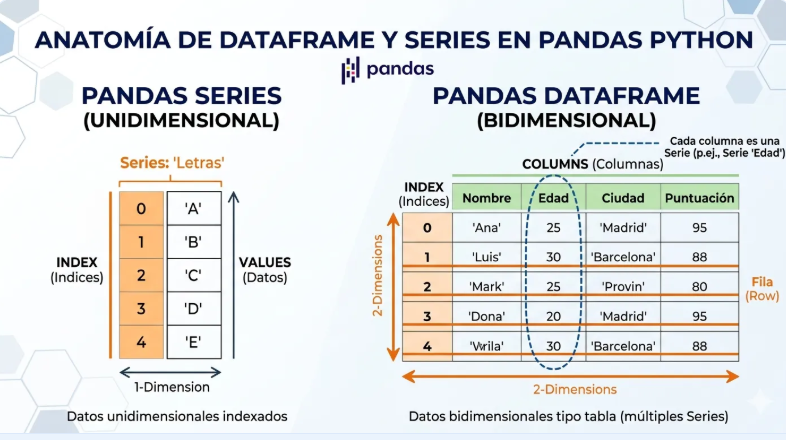
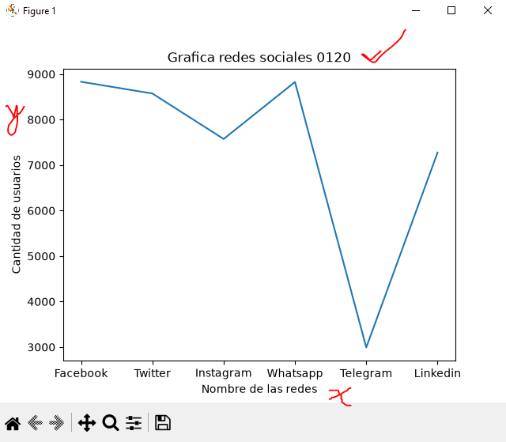
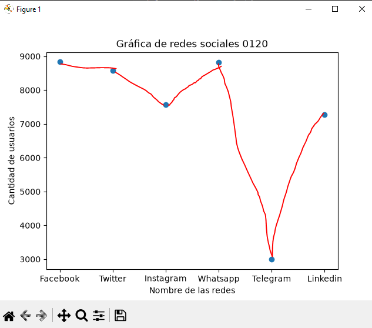
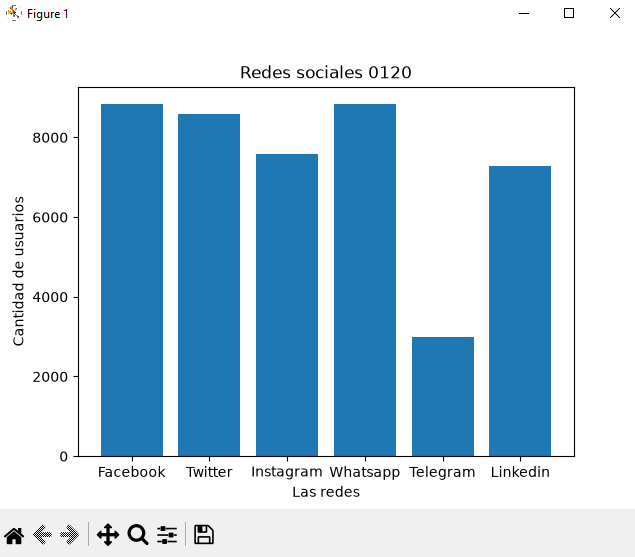
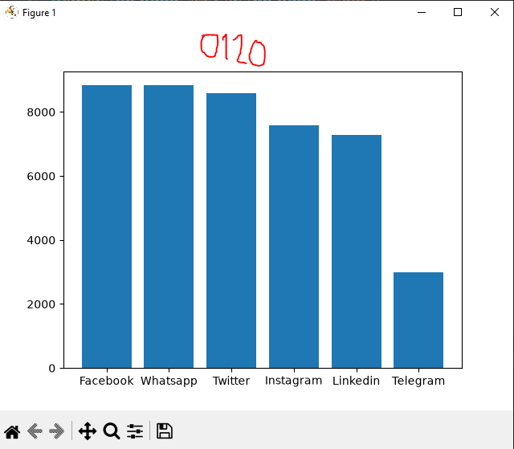
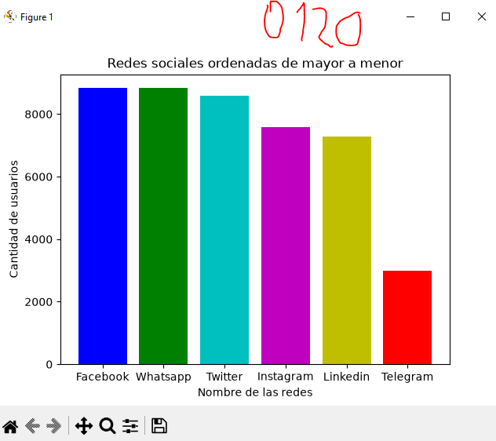
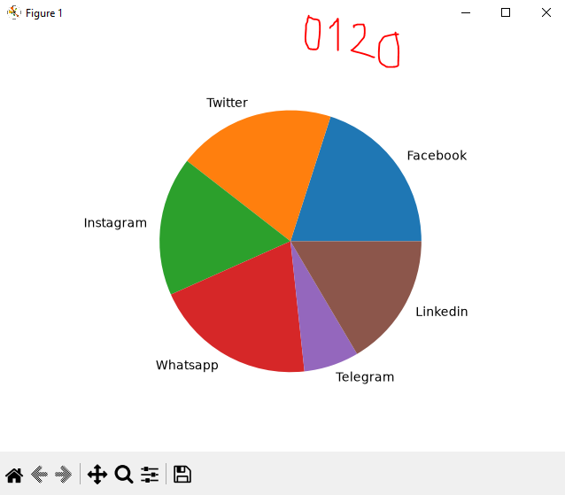

## DataFrame o Marco de Datos Pandas

## Redes sociales a nivel mundial

## Grafica de redes sociales

## Frafica de puntos

## Grafica de barras

## Grafica de barras pequeño al mas grande

## Grafica de barras de colores

## Grafica de pastel o pie
